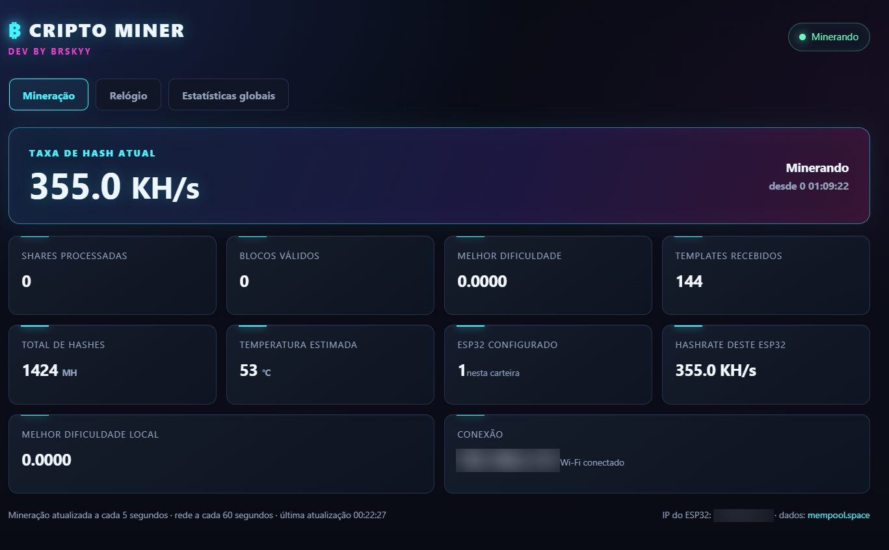
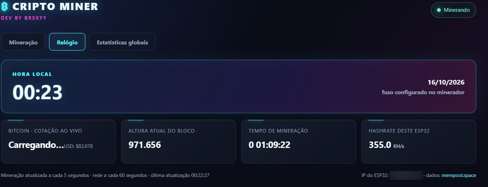
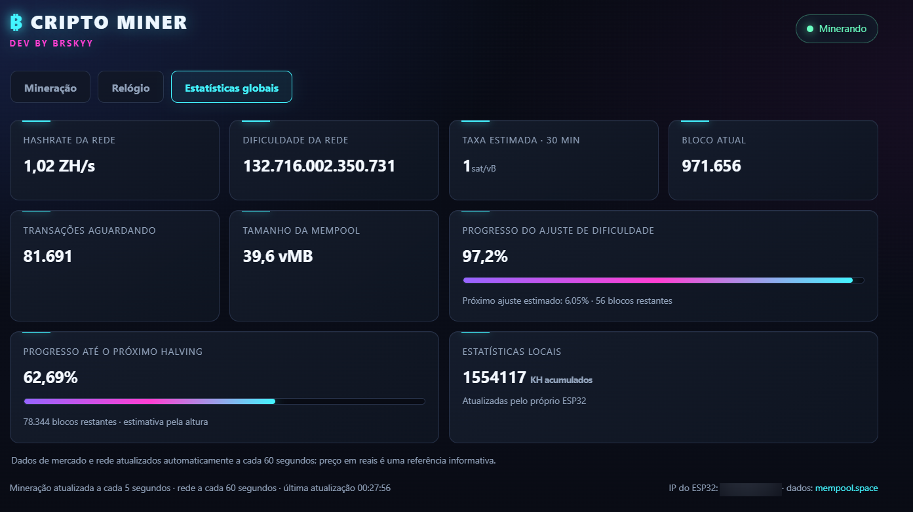

# Cripto Miner

Painel web com visual cyberpunk para acompanhar um ESP32 sem display durante a mineração solo de Bitcoin. Este fork usa como base o [NerdMiner v2](https://github.com/BitMaker-hub/NerdMiner_v2) e acrescenta uma interface web pensada para placas sem tela.

## Por que uma interface web?

Começamos este projeto porque a nossa **ESP32 DevKit V1 com módulo ESP-WROOM-32U não tem tela**. Queríamos acompanhar a mineração e as estatísticas sem comprar ou conectar um display separado. Por isso, criamos uma interface que o próprio ESP32 disponibiliza pela rede Wi-Fi e que pode ser aberta no navegador de um celular ou computador. Assim, o dispositivo continua compacto e o navegador funciona como a tela do minerador.

> **Projeto educativo e experimental.** A mineração em um ESP32 funciona como uma loteria: não há retorno ou recompensa garantidos. Não compre ou use este projeto esperando lucro com mineração.

## O que o painel mostra

- Estado da conexão, hashrate, shares, templates, tempo de atividade e estatísticas locais.
- Relógio e cotação informativa do Bitcoin em BRL e USD.
- Estatísticas da rede, taxas, bloco atual, mempool, ajuste de dificuldade e estimativa do próximo halving.
- Atualização das informações locais a cada 5 segundos e dos dados externos a cada 60 segundos.

O painel é servido pelo próprio ESP32 na rede Wi-Fi local. Os dados de mercado e da rede são consultados pelo navegador na API pública do [mempool.space](https://mempool.space/docs/api/rest); para vê-los, o celular ou computador precisa ter acesso à internet. Se a API estiver indisponível, a mineração local continua, mas os dados externos podem ficar sem atualização.

## Capturas de tela

As imagens mostram as telas de mineração, relógio e estatísticas globais do painel no navegador. Os endereços IP locais foram borrados; cotações e estatísticas de rede variam com o tempo.

### Mineração



### Relógio



### Estatísticas globais



## Hardware e compatibilidade

A configuração do painel web neste repositório foi compilada e gravada em uma **ESP32 DevKit V1 com módulo ESP-WROOM-32U**. O alvo correspondente no PlatformIO é `ESP32-devKitv1`.

Você também precisa de:

- cabo USB com suporte a dados;
- antena adequada ao módulo ESP32 usado;
- computador com PlatformIO para compilar e gravar o firmware.

O firmware original oferece outros alvos de placa, mas a interface web Cripto Miner descrita aqui foi preparada para o alvo `ESP32-devKitv1`. Outros alvos precisam de adaptação e validação próprias.

## Compilar e gravar

Instale o [PlatformIO](https://platformio.org/install) ou a extensão PlatformIO IDE no VS Code. Clone ou baixe este repositório e abra a pasta que contém `platformio.ini` no terminal:

```sh
pio run -e ESP32-devKitv1
```

Para gravar, substitua `COM4` pela porta serial da sua placa. No Linux ou macOS, use o caminho da porta correspondente, por exemplo `/dev/ttyUSB0`:

```sh
pio run -e ESP32-devKitv1 -t upload --upload-port COM4
```

Para acompanhar as mensagens de inicialização:

```powershell
pio device monitor -e ESP32-devKitv1
```

O monitor serial usa **115200 baud**. O endereço do painel aparece no log como `Web dashboard: http://<IP>/`.

## Configuração inicial

1. Grave o firmware e reinicie a placa.
2. Na primeira configuração, conecte-se à rede temporária **NerdMinerAP**. A senha padrão definida no firmware é **MineYourCoins**.
3. Abra o portal de configuração que aparecer no navegador. Se ele não abrir sozinho, acesse `http://192.168.4.1/`. Informe sua rede Wi-Fi, endereço público de recebimento BTC, pool e fuso horário.
4. Depois que o ESP32 entrar na sua rede, encontre o endereço IP no monitor serial.
5. Abra `http://<IP-do-ESP32>/` em um celular ou computador conectado à mesma rede.

Se a placa já tiver uma configuração salva, ela tentará conectar-se a essa rede. O ponto de acesso de configuração também pode aparecer se a conexão falhar. O painel não tem autenticação: dispositivos que alcançam o ESP32 na rede local podem acessá-lo.

## Privacidade e uso

- Não envie senhas de Wi-Fi, chaves privadas ou arquivos de configuração pessoal ao GitHub.
- O endereço BTC é público, mas pode identificar suas transações; remova-o de capturas de tela e logs antes de compartilhar.
- A cotação e as estatísticas externas são informativas e dependem de um serviço de terceiros.
- Este projeto não guarda nem pede chaves privadas da carteira.

## Créditos e licença

Cripto Miner é um projeto derivado do [NerdMiner v2, de BitMaker](https://github.com/BitMaker-hub/NerdMiner_v2), que por sua vez registra o trabalho anterior HAN Miner, de Valerio Vaccaro. Os avisos de copyright e a licença MIT do código-base estão preservados em [`LICENSE`](LICENSE). Consulte também as licenças das bibliotecas incluídas antes de redistribuir binários.

As contribuições específicas do Cripto Miner são disponibilizadas sob os termos da licença MIT incluída neste repositório.

## Contribuir

Relatos de problemas, documentação e melhorias são bem-vindos. Consulte [`CONTRIBUTING.md`](CONTRIBUTING.md) antes de abrir uma contribuição.
